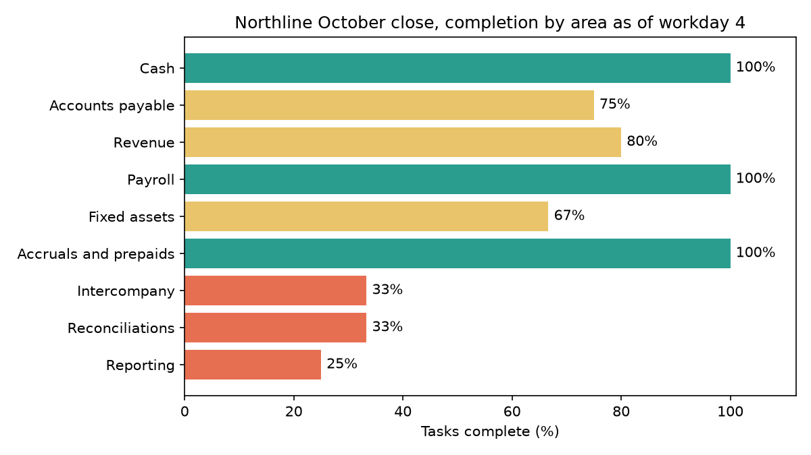

# Northline Month End Close Tracker (Excel)

> Northline is a fictional company. The close tasks, owners and statuses are sample data. No employer or client data is used.

## Problem
Month end close runs on email threads and a checklist nobody trusts. The controller cannot see at a glance which areas are behind, which tasks are blocked by an upstream step, and whether the team will hit a workday 5 close.

## What I built
An Excel close tracker, generated with Python (openpyxl) so it can be rebuilt from a task list in seconds:

* **Settings**: close month, prior month end date, status as of workday, and a company holiday list. All yellow input cells.
* **Tasks**: 32 close tasks across 9 areas with owner, due workday (workday 1 to 5), dependency, status dropdown and completed workday. Formulas calculate the due date with `WORKDAY` (skipping weekends and holidays), days late, the status of the upstream task, and a flag: On track, Done late, Overdue or Blocked by the upstream task ID. Conditional formatting colors the flags.
* **Summary**: completion % by area, done late, open and overdue, blocked, total days late, on time completion rate and a bar chart.
* **Calendar**: each close workday with its date, tasks due, completed, still open and cumulative completion, plus an owner workload table.
* **HTML status page** exported from the recalculated workbook for people who do not open Excel.

Design rules: yellow cells are inputs, black text cells are formulas, no macros, no hardcoded results.

## Key results (sample October 2026 close, status as of workday 4)
| Metric | Result |
|---|---|
| Tasks complete | 22 of 32 (68.8%) |
| On time completion rate | 72.7% of completed tasks |
| Done late | 6 tasks, 8 total days late |
| Open and overdue | 2 tasks (fixed asset rollforward, intercompany matching) |
| Blocked by an upstream task | 4 tasks |
| Areas fully closed | Cash, Payroll, Accruals and prepaids (100%) |
| Areas furthest behind | Reporting 25%, Intercompany 33.3%, Reconciliations 33.3% |
| Formula errors after LibreOffice recalculation | 0 |

### Close calendar
| Workday | Date | Due | Completed | Open | Cumulative completion |
|---|---|---|---|---|---|
| WD1 | Mon Nov 2 | 4 | 4 | 0 | 100.0% |
| WD2 | Tue Nov 3 | 10 | 10 | 0 | 85.7% |
| WD3 | Wed Nov 4 | 9 | 7 | 2 | 73.9% |
| WD4 | Thu Nov 5 | 6 | 1 | 5 | 75.9% |
| WD5 | Fri Nov 6 | 3 | 0 | 3 | 68.8% |

**Takeaway:** the intercompany matching task is overdue and is blocking eliminations, while open reconciliations block controller sign off and the final trial balance. Those two chains are the critical path to a workday 5 close.

## Charts


## How to run
```bash
pip install -r requirements.txt
python src/build_tracker.py        # builds northline_close_tracker.xlsx from data/close_tasks.csv
python src/verify_and_export.py    # recalculates with LibreOffice headless, checks for formula errors,
                                   # writes outputs/summary.csv, outputs/close_status.html and the chart
```
Or just open `northline_close_tracker.xlsx` in Excel, change statuses and the as of workday on Settings, and everything updates.

## Files
```
data/close_tasks.csv            sample close task list
src/build_tracker.py            workbook builder (openpyxl)
src/verify_and_export.py        LibreOffice recalculation check and HTML export
northline_close_tracker.xlsx    the tracker
outputs/close_status.html       status page from recalculated values
outputs/summary.csv             headline close metrics
```

## Stack
Excel (WORKDAY, COUNTIFS, SUMIF, INDEX and MATCH, data validation, conditional formatting), Python openpyxl, LibreOffice headless for formula checks.

## Conclusion
A close tracker is only useful if it shows what is late and why. Linking every task to its upstream step turns a checklist into a critical path view, so the team can unblock the right task first and protect the close date.
